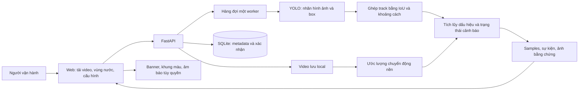

# Thiết kế AquaWatch

Ứng dụng web xử lý tại laptop, không cần tài khoản/dịch vụ cloud. Có hai chế độ: **giám sát tuần tự theo thời gian nguồn** (`mode=realtime`) và phân tích toàn bộ để xem lại (`mode=batch`). Chế độ realtime nạp/làm nóng model trước, sau đó chỉ suy luận frame khi đồng hồ nguồn đến timestamp tương ứng; trả snapshot từng phần mỗi khoảng0,5 giây. Đây là mô phỏng luồng CCTV từ tệp, chưa phải kết nối camera vật lý. Chỉ nhập footage camera trên mặt nước. Xác nhận góc quay ở giao diện là khai báo của người dùng, không phải bộ phân loại góc camera tự động.

## Thành phần và dữ liệu

| Thành phần | Trách nhiệm |
|---|---|
| `aquawatch/api.py` | Kiểm tra upload, schema, tiến độ, lịch sử, export, ack, phục vụ web/video |
| `vision.py` | Nạp checkpoint có checksum, suy luận YOLO, lọc box quá lớn/nhỏ, đo latency |
| `risk.py` | Tracker baseline, thời gian tích lũy, hysteresis, giả thuyết mất dấu có điều kiện |
| `jobs.py` | Một worker, source-time pacing, snapshot atomic, watermark `processed_until`; giữ partial khi hủy/lỗi; EOF sớm không được coi hoàn tất |
| `store.py` | SQLite WAL, truy vấn có tham số, metadata video/job/ack |
| `web/` | HTML/CSS/JS không cần build; phát khi có buffer AI, chặn phát/tua vượt watermark, không tự tiếp tục sau khi người dùng đã pause |
| `library.py` | Đăng ký clip đã duyệt từ catalog; thu hồi bản ghi thư viện khi clip không còn được phê duyệt; không phục vụ video raw qua web |
| `scripts/audit_dataset.py`, `train_detector.py`, `evaluate_detector.py` | Kiểm duyệt, split, fine-tune và so sánh detector |

SQLite có `videos(id, body)`, `jobs(id, body)`, `acknowledgments(job_id,event_id,body)`. Video là tệp riêng; mỗi job có `data/results/<id>/analysis.json` và ảnh JPG. Sự kiện giữ mức cố định theo từng đoạn; tăng mức tạo đoạn mới để không đưa mức tương lai về đầu sự kiện. Các gián đoạn detector ngắn ≤1 giây được gộp cùng episode; không tạo box giả trong đoạn mất detection. Ack nghĩa là người dùng đã xem, không chứng nhận tình huống an toàn và không sửa đầu ra AI.

## Thuật toán và ý nghĩa đầu ra

YOLO dự đoán nhãn học từ ảnh (`drowning`, `swimming`), không xác nhận y khoa. Độ tin cậy là điểm detector, không phải xác suất đuối nước. Nhãn nguồn chưa được chuyên gia cứu hộ xác thực; một số box có thể bao nhóm người.

| Mức | Quy tắc baseline |
|---|---|
| 0: chưa thấy dấu hiệu | Dấu hiệu tích lũy dưới 0,6 giây; không chứng minh an toàn |
| 1: nghi ngờ | Tích lũy nhãn drowning ít nhất 0,6 giây |
| 2: nguy hiểm | Ít nhất 2 giây tích lũy |
| 3: khẩn cấp | Ít nhất 6 giây tích lũy |

Mỗi mẫu quan sát hợp lệ cộng tối đa một chu kỳ lấy mẫu. Nhãn swimming làm giảm bằng 0,65 lần thời gian quan sát; cần ít nhất 2 giây nhãn ít nguy cơ liên tiếp mới cho phép hạ mức. Các ngưỡng là giả thuyết kỹ thuật có kiểm thử logic, **chưa hiệu chỉnh bằng tập sự kiện cứu hộ**. Không trích chúng như ngưỡng sinh lý hoặc chuẩn thương mại.

Mất dấu chỉ sinh giả thuyết nếu: người đã được theo dõi ≥2 giây, vị trí cuối nằm trong polygon nước, không sát biên khung hình, không thấy box đang che phủ, có đủ mốc nền ổn định và chưa có chuyển động camera/cắt cảnh làm mất hiệu lực polygon. Sau 3 giây mất dấu phát nghi ngờ; chỉ nâng mức khi trước đó đã có dấu hiệu nguy hiểm. Không hiện confidence cho suy luận mất dấu. Sau 12 giây vẫn giữ trạng thái chưa xác minh thay vì tự kết luận an toàn. Box nét đứt là **vị trí cuối**.

Ghép lại track sau gián đoạn tối đa 12 giây cần IoU >0,5 và tâm rất gần; đây vẫn là heuristic, có thể nhầm người trong cảnh đông. Không nhận dạng danh tính, không khẳng định người xuất hiện lại chính là người cũ. Người đứng gần không tự làm giảm cảnh báo. Chưa nhận diện hành vi cứu hộ, lặn chủ động, bất động, dòng cuốn hoặc pose độc lập.

## Camera cố định và PTZ

OpenCV tìm đặc trưng nền, optical flow Lucas–Kanade, RANSAC affine; độ dịch chuyển/rotation lớn được xem là góc nhìn thay đổi. Histogram hỗ trợ phát hiện cắt cảnh. Đây là bộ chặn nhầm lẫn, **chưa phải hệ thống PTZ compensation hoàn chỉnh**. Mặt nước, thiếu texture và camera rung đều có thể gây sai. Khi góc nhìn đổi, reset track và vô hiệu hóa giả thuyết mất dấu cho phần còn lại của lượt phân tích; phải chọn đoạn ổn định và vẽ lại vùng. Detector vẫn phân tích ảnh hiện tại. Camera mode được lưu để phân tầng đánh giá; hai chế độ đều dùng bộ chặn chuyển động, không có calibration PTZ riêng.

## Đồng bộ, giới hạn thiết bị và truy cập

UI lấy mẫu gần nhất **không vượt currentTime** và bỏ box quá cũ. Khi job còn chạy hoặc bị hủy/lỗi, chỉ phát/tua trong phần `processed_until`; tự chờ khi hết buffer, chỉ tiếp tục nếu người dùng vẫn muốn phát. Khi hoàn tất mới mở xem lại toàn bộ và export cuối cùng. Không hiển thị sự kiện tương lai trong chế độ giám sát. Các snapshot cập nhật cùng eventID không phát lại âm. Âm báo cần thao tác bật từ người dùng; ứng dụng không điều khiển âm lượng hệ thống. Notifications thường cần secure context/quyền và khác nhau trên điện thoại; vibration không có trên mọi trình duyệt. Manifest hiện chỉ cung cấp metadata, chưa có service worker/offline/push PWA.

Model vẫn được fine-tune bằng ảnh có box. Khi xử lý video, detector kết hợp tracking và logic thời gian; **chưa huấn luyện một mạng action recognition/temporal classifier riêng** vì nguồn ảnh không có ground truth thời gian đáng tin cậy. Vận hành theo thời gian thực và hiểu hành vi video là hai thuộc tính phải đánh giá riêng.

Mặc định bind localhost. `RUN.ps1 -Lan` mở dịch vụ cho mạng nội bộ khi người dùng chủ động chạy; chưa có đăng nhập/TLS, chỉ dùng mạng tin cậy cho demo. Không mở port Internet hay tự thay firewall. HTTP LAN không bảo đảm Notifications/PWA; video và âm thanh trong trang còn phụ thuộc trình duyệt. Thực tế điện thoại/âm thanh chưa kiểm tra được trong phiên do công cụ UI không kết nối.

Hướng mở rộng: bảng camera/khu vực, queue riêng theo camera, tracker mạnh hơn, bù chuyển động PTZ, annotation temporal, classifier hành vi, authentication trước khi dùng nhiều người. Không có gửi email/Telegram/cuộc gọi thật trong bản này.
