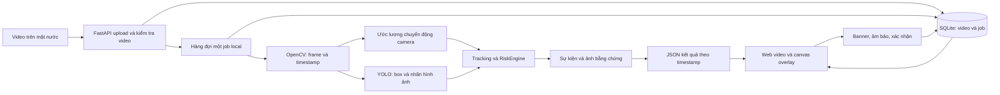

# Giải pháp và kế hoạch nghiệm thu AquaWatch

Mốc khảo sát: **28/10/2026**. Khuyến nghị xây dựng ứng dụng web **chạy local trên laptop**, phân tích trước video rồi phát lại kết quả theo đúng timestamp. Bản học thuật phải có **fine-tuning thực**, log/checkpoint và đo lường thật. Phạm vi nhận diện hiện tại là **dấu hiệu nghi nguy cơ theo nhãn mô hình và diễn biến quan sát được**, không xác nhận mọi trường hợp đuối nước.

Tài liệu này là thiết kế và kế hoạch. Trạng thái thực của huấn luyện lấy từ `training_record.json`; kết quả runtime lấy từ `data/results/<job>/analysis.json`; việc hoàn tất kiểm thử giao diện phải có bằng chứng nghiệm thu riêng.

## 1. Phân tích yêu cầu và căn cứ

| Nguồn yêu cầu | Nội dung | Ý nghĩa đối với bản nộp |
|---|---|---|
| Giảng viên, **do người dùng thuật lại** | Người cầu cứu trong nước → phát hiện → đánh dấu → thông báo/cảnh báo; xét tình huống chìm; hiện chưa bắt buộc camera thật. | Có pipeline video–AI–box–risk–alert thực. Không viện dẫn đây là nội dung rubric đã có trong slide. |
| Thông tin làm rõ của người dùng | **Bắt buộc tự train hoặc fine-tune.** | Inference bằng pretrained hoặc chỉnh threshold chưa đáp ứng. Cần lần tối ưu mạng thật, logs, dữ liệu/split và weights. |
| Bốn bài giảng đã đọc | 120 slide về NumPy, Matplotlib, scikit-learn, OpenCV, supervised learning, train/test, loss, gradient descent, overfitting và deep learning. | Liên hệ đúng phương pháp học máy và quy trình đánh giá. Các bài CIFAR-10 có ngưỡng riêng, không chuyển thành tiêu chí accuracy drowning. Xem `LECTURE_ALIGNMENT.md`. |
| Người dùng mở rộng | Video trên mặt nước; nhiều môi trường; camera cố định/PTZ; nhiều mức cảnh báo; web/điện thoại; lịch sử, bằng chứng; nghiên cứu đủ bảy nguồn; nguồn/license; miễn phí. | Ưu tiên flow hoàn chỉnh và dữ liệu hợp lệ trước tính năng nâng cao. UI/CSDL/kiến trúc là yêu cầu sản phẩm, không phải kiến thức UML đã được tìm thấy trong slide. |

Giới hạn cần giữ trong mọi báo cáo: detector ảnh chưa tự hiểu chuỗi hành vi; không nhìn xuyên nước đục; mất dấu có thể do che khuất/PTZ; đứng gần không chứng minh đã cứu; accuracy trên pool không chứng minh hiệu quả biển/sông/lũ. Huấn luyện được phép dùng video cầm tay **trên mặt nước**, trong khi test triển khai chính phải giống CCTV cố định vị trí.

## 2. Căn cứ lựa chọn dữ liệu và mô hình

`DATA_RESEARCH.md` và `sources.json` ghi khảo sát đủ bảy nguồn. Các quyết định chính:

- Figshare Underwater và dữ liệu camera underwater của bài Springer bị loại khỏi train/validation/test/demo.
- Bài Sensors dùng dữ liệu trộn góc nhìn: chỉ tham khảo thiết kế; không đưa nguyên dataset vào hệ thống.
- nweweq có 264 ảnh nhưng 0 version/0 model; chưa phải nguồn weights/export sẵn. Kaggle Alanoud chưa rõ license nên chưa chọn.
- Deep Rescue được tải và đếm thật; tập con **192 ảnh** đã duyệt được chia **121/43/28** theo ba nhóm cảnh. Giữ dữ liệu/manifest/audit; không dùng nguyên kho 9.990 ảnh chứa cả underwater/stock.
- Nhãn `drowning/swimming` của nguồn vẫn là **nhãn yếu**; uploader khai CC0 nhưng COCO ghi Unknown. Quyền gốc footage và tính đúng nghĩa của nhãn chưa được chứng minh đầy đủ.
- Thí nghiệm khởi tạo từ checkpoint YOLOv8s cộng đồng rồi fine-tune local. Ba nhóm cảnh chỉ tách biệt trong **lần fine-tuning này**; training upstream không rõ nên không được gọi test độc lập với pretraining. Bước tiếp theo cần baseline khởi tạo COCO tổng quát và dữ liệu nguồn rõ hơn.

So sánh AI: detector nhỏ cho box và score dễ tích hợp; tracking/temporal logic xử lý tính liên tục nhưng chưa là action model đã học. Pose có thể bổ sung cử động nhưng dễ hỏng với người nhỏ/che khuất. Video action/temporal localization phù hợp diễn biến hơn nhưng cần clips có nhãn onset/end và nhiều sự cố độc lập. Vì dữ liệu temporal hiện thiếu, chưa chọn các mô hình lớn làm phụ thuộc của MVP.

## 3. So sánh giao diện và triển khai

| Phương án | Lợi ích | Đánh đổi | Lựa chọn |
|---|---|---|---|
| Web local: FastAPI + HTML/CSS/JavaScript | Python AI cùng backend; video/canvas overlay; trình duyệt Windows và viewport điện thoại; mở LAN khi cần. | Âm thanh cần tương tác/quyền; rung/notification không đồng đều; LAN cần mạng/firewall phù hợp. | **Chọn cho MVP.** Một backend phục vụ giao diện, không cần build frontend hoặc cloud. |
| Windows Forms | Giao diện desktop, tích hợp Windows tốt. | Cần lớp nối Python/.NET hoặc đóng gói runtime; điện thoại cần giao diện khác. | Phương án dự phòng nếu rubric bắt buộc desktop native; hiện người dùng không yêu cầu. |
| Streamlit/Gradio | Dựng thử mô hình nhanh. | Khó kiểm soát playback, overlay và cảnh báo chính xác khi tua/pause ở mức mong muốn. | Dùng thử AI khi cần; không chọn làm giao diện chính. |

| Tài nguyên | Độ khả thi/chi phí | Thời gian, chất lượng và rủi ro |
|---|---|---|
| **A. Full local**: train và chạy toàn bộ trên laptop | Không phí dịch vụ, không quota cloud, giữ dữ liệu tại máy. Phần cứng đã kiểm: RAM 16 GB, 12 CPU logical, RTX 2060 6 GB. | Phù hợp detector nhỏ/batch nhỏ; train từ đầu đòi dữ liệu/compute lớn hơn. Không hứa số epoch/phút hoặc chất lượng trước thực nghiệm. |
| **B. Hybrid local + Kaggle/Colab** | Cloud train, tải weights về local; mở rộng khi dữ liệu lớn. | Cần tài khoản, quota/availability và chuyển dữ liệu. Không dùng cloud làm phụ thuộc cho buổi demo. |
| **C. Pretrained + fine-tune local** | Tiết kiệm compute, thực hiện được yêu cầu tự tối ưu mạng; kết hợp được tracking/risk riêng. | Chất lượng không bảo đảm tốt hơn baseline. Community initialization có provenance yếu; phải nêu rõ và làm ablation tiếp. **Chọn kết hợp C với A.** |

Môi trường đang sử dụng: **Python 3.12.10**, PyTorch **2.7.1+cu126**, torchvision **0.22.1+cu126**, CUDA 12.6; dependency thực và cấu hình run được lưu trong dự án. Không dùng Python 3.14 hệ thống để thay thế môi trường ảo đã cài cho AI.

Kiểm tra nguồn chính thức ngày 28/10/2026: [Kaggle Efficient GPU Usage](https://www.kaggle.com/docs/efficient-gpu-usage) mô tả quota tuần 30 giờ hoặc cao hơn tùy nhu cầu/tài nguyên; quota hiển thị trong tài khoản mới là căn cứ thực tế. [Kaggle Notebooks](https://www.kaggle.com/docs/notebooks) nêu giới hạn phiên và storage. Chưa đăng nhập/khởi tạo GPU cloud trong dự án nên không khẳng định tài khoản hiện có quota. [Colab FAQ](https://research.google.com/colaboratory/faq.html) xác nhận giới hạn và GPU thay đổi, không bảo đảm tài nguyên; phiên miễn phí tối đa 12 giờ còn tùy availability/usage. Không cần mua gói trả phí cho MVP.

## 4. Kiến trúc tổng thể được chọn

Backend đọc video thật bằng OpenCV; worker xử lý một video để tránh tranh GPU, cập nhật tiến độ/lỗi/hủy. Frontend poll API rồi dùng kết quả đã xử lý, phát video theo dòng thời gian gốc. Chế độ giám sát chỉ hiển thị sự kiện đến thời điểm đang xem; chế độ xem lại toàn bộ phải được ghi rõ. Tua/pause không được phát sự kiện tương lai.

SQLite lưu metadata video/job và acknowledgment; JSON lưu samples, events, summary; JPG lưu bằng chứng. `acknowledgments` tách khỏi model output: **đã xem** không có nghĩa **đã an toàn**. Export JSON/CSV giữ timestamps, ID, mức và lý do. File upload giới hạn 1 GB/30 phút, tên lưu do hệ thống tạo; cache/model/data đều nằm trong `D:\httm`.

Camera mode fixed/PTZ và vùng nước là cấu hình của nguồn. Ước lượng chuyển động camera hiện làm **guard**, chưa phải hệ thống bù chuyển động/ID tracking hoàn chỉnh. Khi có pan/cut, chuỗi track được reset và suy luận mất dấu bị vô hiệu trong lần xử lý đó để tránh dùng polygon cũ. Không tuyên bố PTZ đã đạt độ chính xác tương đương camera tĩnh.

Thiết kế mở rộng sau này thêm camera/source/location vào metadata và tách worker theo tài nguyên; UI/AI/event vẫn giao tiếp qua API và kết quả có cấu trúc. Chưa xây dựng đầy đủ multi-camera, tài khoản hoặc phân công cứu hộ trong MVP.

## 5. Cơ chế mức cảnh báo và đồng bộ

Các ngưỡng hiện tại là **mặc định kỹ thuật cần hiệu chỉnh bằng video có nhãn**, không phải mốc y khoa hoặc chuẩn cứu hộ:

| Mức | Điều kiện hiện được thiết kế trong RiskEngine | Hiển thị/ý nghĩa |
|---|---|---|
| 0 | Chưa tích đủ bằng chứng nguy cơ. | Không có bằng chứng model đủ ngưỡng; không phải chứng nhận mọi người an toàn. |
| 1 — Nghi ngờ | Tích lũy nhãn drowning khoảng 0,6 giây. | Theo dõi, hiển thị lý do và đối tượng. |
| 2 — Nguy hiểm | Bằng chứng tích lũy khoảng 2 giây. | Khung đỏ/banner và âm báo khi người dùng đã bật âm. |
| 3 — Khẩn cấp | Bằng chứng tích lũy khoảng 6 giây. | Ưu tiên chú ý cao hơn; cần con người xem và quyết định. |

Nhãn swimming làm bằng chứng giảm theo thời gian; hạ mức cần khoảng 2 giây quan sát rõ để hạn chế nhấp nháy. Event theo track/mức và gộp khoảng hụt ngắn; frontend kiểm soát phát lại/cooldown. Mất dấu chỉ được suy luận khi có vùng nước, track đủ lịch sử, không sát mép/che khuất/pan/cut và camera motion có thông tin; hiển thị **vị trí cuối, chưa xác nhận chìm**. Không vẽ box suy luận như một detection hiện thời.

Âm thanh dùng Web Audio sau thao tác bật/test, có điều chỉnh âm lượng trong ứng dụng. Rung và Notifications chỉ thử khi feature/quyền/secure context hỗ trợ; không tự tăng âm lượng hệ điều hành, không bảo đảm rung trên iOS hay mọi trình duyệt. Không tự gọi cứu hộ hoặc gửi thông báo ngoài hệ thống thật.

## 6. MVP, phiên bản đầy đủ và giới hạn hiện tại

| Phạm vi | Đã có mã hoặc artifact thực | Cần nghiệm thu / chưa đạt |
|---|---|---|
| Flow MVP | Upload video, kiểm tra metadata, AI thật, tracking, mức thời gian, tiến độ/hủy, JSON/events/evidence, SQLite, playback/canvas, lịch sử/ack/export. | Chạy kiểm tra tích hợp và UI toàn flow; ghi riêng phần đã kiểm trực tiếp, không suy từ source. |
| Fine-tuning bắt buộc | `finetune_v2` đã hoàn tất8 epoch trên192 ảnh, ảnh416/batch4/seed42; có log/loss/record/hash/weights và so sánh validation/test thật. | Test theo cảnh mới mAP50 chỉ6,72%; chưa đạt chất lượng. `finetune_v1` lỗi WinError5 được giữ riêng. Xem `VALIDATION.md`. |
| Đo hiệu năng baseline | Job `82de634003054c088e225cbd4618ffca` đã tạo `analysis.json`: video 105,6055 giây, xử lý 22,032 giây, 528 samples, 74 detections, 21 events, mức tối đa 2; mean inference 29,84 ms. | Đây là throughput pipeline và đầu ra dự đoán, **không phải 21 sự cố thật hay accuracy**. Chưa có GT độc lập. Không suy mean inference thành event latency. |
| Phiên bản học thuật đầy đủ | Bổ sung đánh giá ảnh và sự kiện; baseline/fine-tune ablation; video ngoài dataset; test âm/đồng bộ/điện thoại. | Cần nhãn đúng, nhiều nguồn/camera, negative khó, giải quyết provenance/license trước tuyên bố chất lượng. |
| Tương lai | Action model, pose, theo dõi cứu hộ, multi-camera/location, liên hệ người phụ trách. | Chưa có dữ liệu/kiểm thử để khẳng định nhận diện bất động, dòng cuốn, mất ý thức, chìm mọi trường hợp hoặc cứu hộ thành công. |

## 7. Kế hoạch theo phụ thuộc và tiêu chí hoàn thành

| Ưu tiên | Công việc / phụ thuộc | Tiêu chí hoàn thành | Rủi ro / dự phòng |
|---|---|---|---|
| P0 | Đọc nguồn, khảo sát môi trường và 7 liên kết. | Có trích xuất slide, bảng nguồn và phần chưa xác minh. | Web thiếu thông tin: ghi chưa xác minh, không tự bịa. |
| P0 | Duyệt dữ liệu → audit → split nguồn/cảnh. | Manifest giữ/loại, hashes, class mapping và không trùng nhóm qua split. | Thiếu nguồn/license/nhãn: chỉ thí nghiệm thăm dò; tìm nguồn khác, không công bố như dataset chuẩn. |
| P0 | Fine-tune thật trên GPU; phụ thuộc dataset audit. | Logs loss/optimizer, record thành công, weights đầu/cuối, cấu hình tái hiện; ghi rõ ít epoch/tập nhỏ. | Lỗi quyền: cache local và lưu đúng thư mục; OOM: giảm batch/imgsz; cloud miễn phí chỉ khi local không khả thi. |
| P0 | Upload → inference → playback → alert. | Video mới chạy end-to-end; boxes đúng tọa độ, âm sau opt-in, không cảnh báo tương lai. | Codec lỗi: báo rõ/chuyển định dạng hợp lệ; model lỗi phải dừng job, không tạo detection giả. |
| P1 | So sánh baseline và fine-tune trên validation khóa. | Cùng dữ liệu/tham số đánh giá; lưu metrics thật và class confusion; không mặc định fine-tune tốt hơn. | Nhãn yếu/ít lớp dương: báo giới hạn, xem lại ảnh và mở rộng dữ liệu. |
| P1 | Test event độc lập sau khi chọn model/threshold. | Nhãn track/onset/end; event precision/recall, FP/hour, miss rate, latency và FPS; giữ test khỏi tối ưu. | Thiếu GT hoặc upstream overlap chưa rõ: chỉ báo smoke/performance, không gọi accuracy độc lập. |
| P1 | UI desktop, viewport hẹp và điện thoại/LAN. | Bằng chứng upload/play/pause/seek/ack/export; trạng thái quyền âm/rung/notification rõ. | Chưa có điện thoại thật: ghi chỉ kiểm responsive; LAN bị chặn: localhost demo, không mở Internet. |
| P2 | Camera xoay, negative khó, nhiều người/môi trường. | Báo kết quả riêng fixed/PTZ và pool/beach/river/flood khi có dữ liệu. | Motion estimate/ID switch lỗi: vô hiệu missing inference, báo chưa đủ quan sát. |
| P2 | Chuẩn bị báo cáo/bảo vệ. | README lệnh cài/chạy/train/test/demo, nguồn/license, sơ đồ, bảng slide và hạn chế có thể kiểm chứng. | Rubric/hình thức nộp chưa có: chuẩn bị artifact tái hiện trước, điều chỉnh định dạng khi được cung cấp. |

Nghiệm thu cuối gồm ba cổng riêng: **chạy được phần mềm**, **đã thực hiện fine-tuning**, và **chất lượng trên dữ liệu độc lập**. Qua một cổng không tự động đạt hai cổng còn lại. Không có số precision/recall/F1 hoặc event latency nếu chưa đo bằng ground truth phù hợp.

## 8. Những quyết định cần người dùng khi chuẩn bị nộp

Quyết định quan trọng về tự train/fine-tune đã được làm rõ; tiếp tục triển khai local không cần chờ thêm. Những thông tin còn thiếu có thể ảnh hưởng bản nộp gồm rubric chính thức, hình thức báo cáo/số trang, thành phần bắt buộc phải tự cài và yêu cầu đóng gói. Khi chuẩn bị bàn giao học thuật, cần đối chiếu chúng với sản phẩm và nguồn dữ liệu; chưa tự suy ra các quy định này từ bài tập CIFAR-10 hoặc từ tên môn học.
